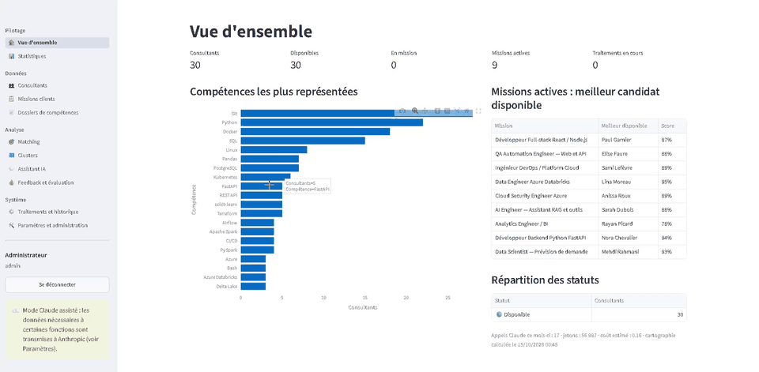
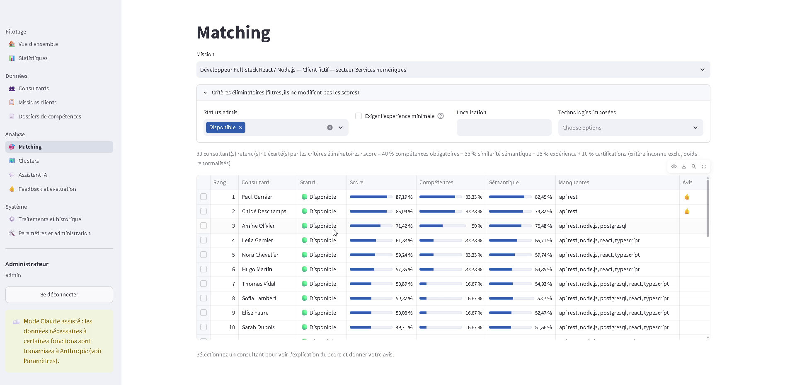
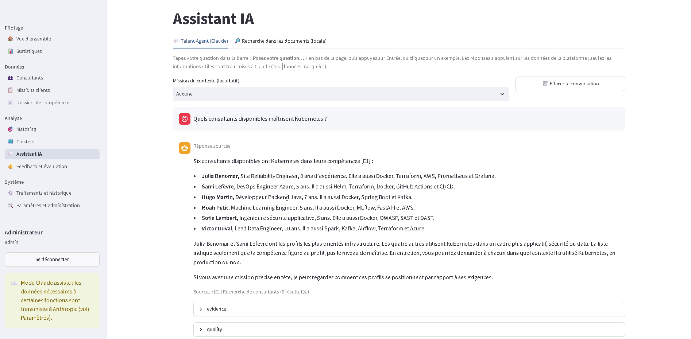
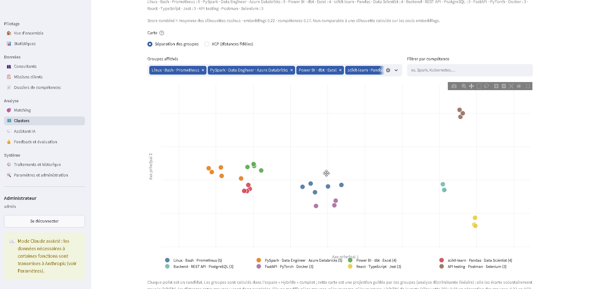
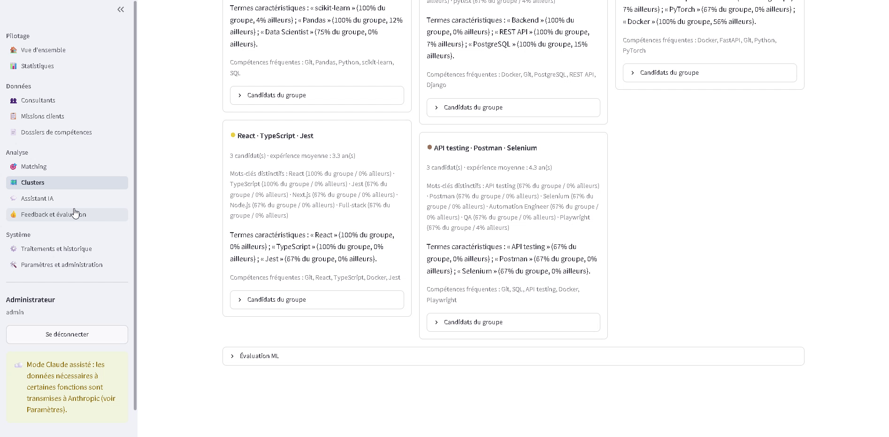
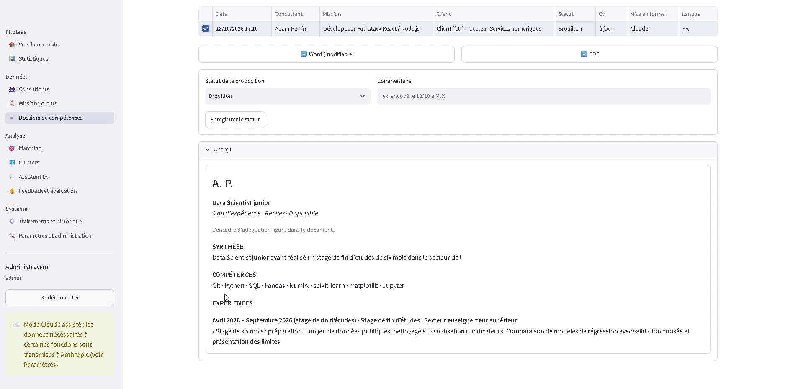
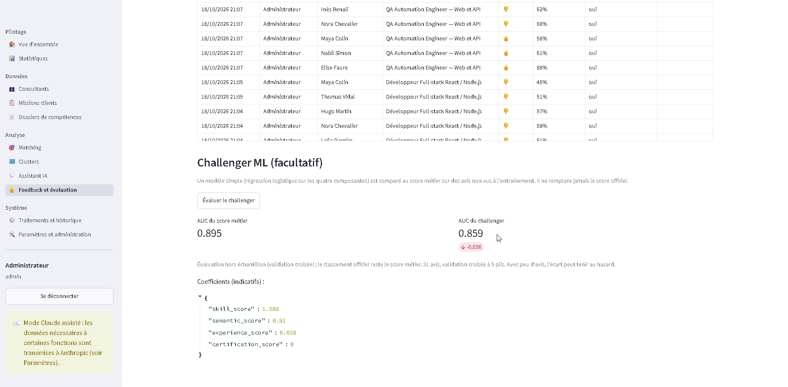
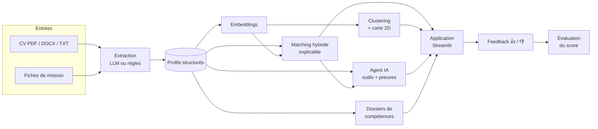

# Talent Intelligence Platform

**Trouver le bon consultant pour une mission, expliquer pourquoi, et le vérifier.**

Plateforme de staffing pour une ESN : elle lit des CV et des fiches de mission hétérogènes (PDF, Word, texte),
classe les consultants pour chaque mission avec un score explicable, cartographie les profils, répond aux
questions des recruteurs avec des sources vérifiables et génère des dossiers de compétences anonymisés.

Le projet existe en **deux éditions** :
- une édition **Cloud** sur Databricks et Azure ;
- une édition **locale** sur Docker, conçue pour que les CV ne quittent pas la machine.

> Ce dépôt est une **vitrine** : présentation, captures, vidéo et choix techniques. Le code source est privé et
> **disponible sur demande** pour un entretien.

## 🎬 Démonstration

▶️ **[Vidéo de démonstration (1 min 38)](media/demo.mp4)** : édition locale, jeu de 30 CV et 9 missions **fictifs**.

## Fonctionnalités

| | |
|---|---|
| **Extraction des CV et des missions** | Lecture PDF / DOCX / TXT et profil structuré (compétences, expériences, certifications, années). Extraction par LLM ou par règles locales. Versionnement des CV et déduplication. |
| **Matching explicable** | Score hybride : 40 % compétences obligatoires, 35 % similarité sémantique, 15 % expérience, 10 % certifications. Décomposition détaillée, filtres éliminatoires, rang du candidat face au reste du classement, comparaison côte à côte de la fiche de mission et des CV du top 3. |
| **Cartographie des profils** | Clustering non supervisé des consultants, avec un nombre de groupes choisi automatiquement. Familles nommées par leurs termes distinctifs. Carte 2D (ACP et LDA). |
| **Assistant IA agentique** | Questions en langage naturel. L'agent appelle des outils (recherche, profils, scores, comparaison, couverture de compétences) et chaque affirmation cite une preuve (E1, E2…). Une réponse sans preuve valide est rejetée. |
| **Dossiers de compétences** | CV anonymisé au format de l'entreprise, en Word et PDF, ciblé sur une mission. Mise en forme optionnelle par LLM, vérifiée : une compétence ou un chiffre inventé fait rejeter la version. |
| **Boucle de feedback** | Avis 👍 / 👎 des recruteurs et évaluation d'un modèle d'apprentissage concurrent du score métier. |
| **Pilotage** | Vue d'ensemble, statistiques, suivi des traitements, consommation et budget LLM, journal d'audit. |

## Captures

| Matching expliqué | Assistant avec sources |
|---|---|
|  |  |
| **Carte des profils (clusters)** | **Familles de compétences** |
|  |  |
| **Dossier de compétences** | **Évaluation par le feedback** |
|  |  |

Les autres captures sont dans [media/screenshots](media/screenshots).

## Architecture

| | Édition Cloud | Édition locale |
|---|---|---|
| **Infrastructure** | Databricks : Unity Catalog, Jobs, Databricks Apps | Docker Compose : 3 conteneurs, base non exposée |
| **Données** | Tables Delta (bronze, silver, gold) et Volumes | PostgreSQL 16 avec pgvector |
| **Extraction et agent** | Azure AI Foundry (GPT-4.1-mini) | LLM externe via API (Anthropic), désactivable |
| **Embeddings** | `text-embedding-3-large` | Modèles open source locaux : Qwen3-Embedding-0.6B sur GPU, e5-small sur CPU |
| **Recherche documentaire** | Foundry File Search / Vector Store | Recherche vectorielle pgvector |
| **Confidentialité** | Données dans le tenant Azure | Mode **100 % local** possible : aucun appel externe |

Détails : [docs/architecture.md](docs/architecture.md).

## Résultats mesurés

| Mesure | Résultat |
|---|---|
| Accord du score avec le jugement d'un recruteur | **AUC 0,895**, soit environ 9 paires sur 10 bien ordonnées (31 avis) |
| Modèle d'apprentissage concurrent | AUC 0,859 : **ne fait pas mieux**, le score explicable est conservé |
| Stabilité du clustering (ARI) | **0,66** en local, 0,61 sur le Cloud |
| Choix du modèle d'embeddings | 3 modèles open source comparés : **Qwen3** retenu sur GPU (AUC 0,95 sur les paires de compétences), **e5-small** sur CPU (100× plus rapide sans GPU) |
| Coût d'une question à l'assistant | **≈ 0,01 à 0,02 $** |
| Tests automatisés (édition locale) | **92** : unitaires, intégration PostgreSQL et interface |

Méthode et limites : [docs/evaluation.md](docs/evaluation.md).

## Choix techniques

- **Un score explicable plutôt qu'une boîte noire.** Chaque point du score se justifie face à un recruteur. Un
  modèle appris a été évalué sur les avis réels : il ne fait pas mieux, donc il n'est pas utilisé pour classer.
- **Un LLM encadré.** Le LLM extrait et reformule, mais ne décide pas. L'agent doit citer une preuve issue des
  outils pour chaque affirmation. Les reformulations des dossiers sont vérifiées mot à mot face au CV.
- **La confidentialité par conception.**
  - Coordonnées masquées avant tout envoi à un LLM.
  - Mode entièrement local et fonctionnalités LLM activables une à une.
  - Anonymisation contrôlée des dossiers, avec génération bloquée si une donnée personnelle subsiste.
  - Sauvegardes chiffrées (AES-256-GCM), rôles (lecteur, manager, administrateur) et journal d'audit.
- **Des calculs incrémentaux.** Signatures de paires (CV, mission, modèle, version du score) : seul ce qui a
  changé est recalculé. File de traitements PostgreSQL (`FOR UPDATE SKIP LOCKED`).
- **Des coûts maîtrisés.** Budget mensuel LLM, plafond de jetons par opération et suivi par appel.

Détails : [docs/choix-techniques.md](docs/choix-techniques.md).

## Stack

`Python` · `Streamlit` · `PostgreSQL` · `pgvector` · `Docker` · `Databricks` · `Delta Lake` · `Azure AI Foundry` ·
`sentence-transformers` · `PyTorch` · `scikit-learn` · `Plotly` · `pytest`

## Données

Toutes les captures et la vidéo utilisent un **jeu de données fictif** : 30 CV et 9 missions générés pour les
tests. Aucun CV réel n'apparaît dans ce dépôt.

## Auteur

**Zakaria Fayssal**. Code source disponible sur demande.
