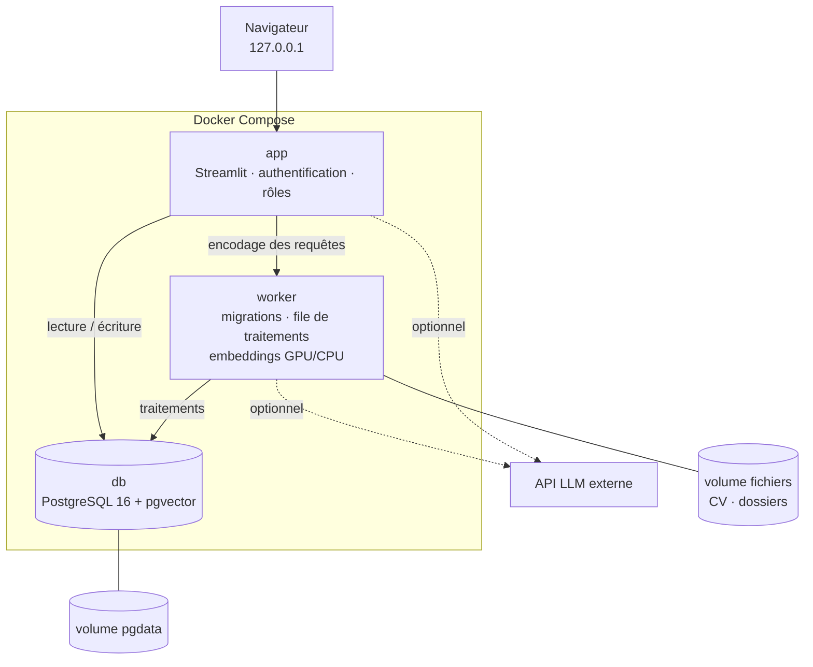
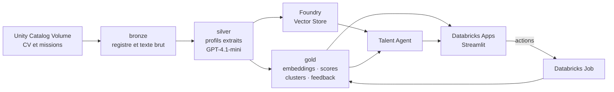
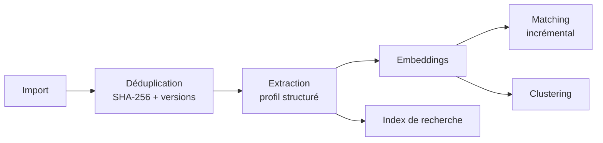
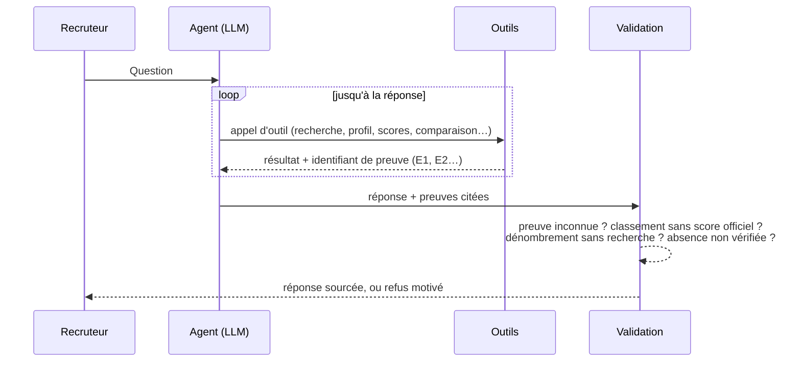

# Architecture

## Édition locale (Docker)

- **3 conteneurs.**
  - `db` : aucun port publié, sur un réseau interne sans accès Internet.
  - `worker` : exécute les traitements longs, comme l'analyse des CV, le matching, le clustering et l'indexation.
  - `app` : sert l'interface.
- **Une seule base.** PostgreSQL stocke à la fois les données relationnelles et les vecteurs (pgvector). Les
  volumes d'une ESN ne justifient ni Spark, ni une base vectorielle séparée, ni un broker de messages.
- **Une file de traitements dans PostgreSQL.** `SELECT … FOR UPDATE SKIP LOCKED` : pas de dépendance
  supplémentaire, et les reprises sont garanties.
- **Des embeddings locaux.** Le modèle est choisi selon le matériel :
  - Qwen3-Embedding-0.6B (1024 dimensions) sur GPU ;
  - e5-small sur CPU.

  Changer de modèle déclenche le recalcul des vecteurs concernés, et lui seul.
- **Deux modes de confidentialité.**
  - **Local** : aucun appel externe. L'extraction se fait par règles et l'assistant est désactivé.
  - **LLM assisté** : fonctionnalités activables une à une. Les coordonnées sont masquées avant envoi.

## Édition Cloud (Databricks / Azure)

- Architecture **médaillon** en tables Delta : `bronze` pour le brut, `silver` pour le structuré, `gold` pour
  les résultats.
- Les traitements tournent en **notebooks et Jobs Databricks**, de façon incrémentale, sur les nouvelles versions
  de CV seulement.
- Extraction et agent sur **Azure AI Foundry** (GPT-4.1-mini). Embeddings : `text-embedding-3-large`.
- L'application, sur **Databricks Apps**, ne lance pas Spark. Ses actions (disponibilité d'un consultant,
  recalculs) passent par un Job.

## Pipeline commun

Chaque étape est **idempotente**. Une signature (version du CV, profil de mission, modèle d'embeddings, version
du score) permet de ne recalculer que les paires candidat–mission qui ont changé.

## Agent IA

**Outils disponibles :**
- recherche de consultants et de missions ;
- profil détaillé ;
- meilleurs candidats d'une mission ;
- détail d'un score ;
- comparaison de 2 à 4 consultants ;
- couverture de compétences ;
- groupe (cluster) d'un consultant ;
- recherche dans les documents.

**Télémétrie de chaque réponse :** latence, nombre d'appels, jetons, coût estimé, preuves citées, contrôles
qualité et versions des données lues.
